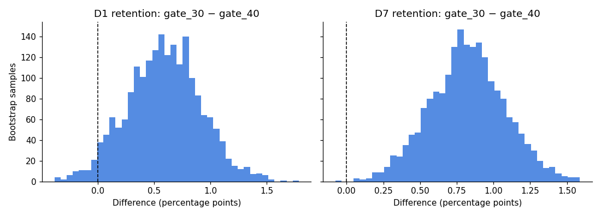

# Cookie Cats A/B Test: Gate at Level 30 vs 40

A product analysis of a real A/B test on **90,189 players** of *Cookie Cats*, a casual match-3 mobile puzzle game. The test asked whether moving the first progression gate from **level 30 to level 40** changes player retention, and whether the change should ship.

👉 **Full analysis:** [`analysis.ipynb`](analysis.ipynb)

## TL;DR

**Recommendation: keep the gate at level 30.** Moving it to level 40 significantly lowers 7-day retention, and nothing else improves enough to offset that.

| Metric | gate_30 (control) | gate_40 (treatment) | Difference | p-value |
|---|---|---|---|---|
| **D7 retention** (primary) | 19.02% | 18.20% | **−0.82 pp (−4.3%)** | **0.002** ✅ significant |
| D1 retention | 44.82% | 44.23% | −0.59 pp (−1.3%) | 0.074 (n.s.) |
| Game rounds (median) | 17 | 16 | ~0 | 0.051 (n.s.) |

- **Business impact:** for every 1M new installs, gate_40 would mean about **8,200 fewer players still active on day 7**. That is a smaller audience for LiveOps, ads, and IAP.
- **Robustness:** a bootstrap with 2,000 resamples shows gate_30 retaining better at D7 in more than 99.9% of resamples.



## Approach

1. **Data quality:** checked for duplicates and missing values, ran a **Sample Ratio Mismatch (SRM)** check, and removed one bot-like outlier (49,854 rounds in 14 days).
2. **Retention:** two-proportion z-test with 95% confidence intervals, plus a bootstrap for robustness.
3. **Engagement:** Mann-Whitney U test, because game rounds are heavily right-skewed.
4. **Segmentation:** repeated the test for players who likely reached the gate (30+ rounds).
5. **Decision:** recommendation, business impact, caveats, and follow-up experiments.

## Key caveats

- **The SRM check fails** (p ≈ 0.009; split is 49.6% / 50.4%). In production I would investigate the assignment and logging before making a final call.
- **No revenue data.** Gates also drive monetization, so a full decision would add conversion, ARPDAU, and LTV per variant.
- Game rounds are only a proxy for level progress.

## Next experiments I'd propose

- Gate at **level 25 vs 30**: would an even earlier break help retention more?
- **Gate format:** wait-timer length, and rewarded-ad unlock vs IAP-only, to measure the retention vs monetization trade-off.
- Add **guardrail metrics** (session length, D30 retention, IAP conversion) to gate tests.

## Run it

```bash
python3 -m venv .venv && .venv/bin/pip install -r requirements.txt
curl -L -o data/cookie_cats.csv https://raw.githubusercontent.com/ryanschaub/Mobile-Games-A-B-Testing-with-Cookie-Cats/master/cookie_cats.csv
.venv/bin/jupyter notebook analysis.ipynb
```

**Data:** Cookie Cats A/B test dataset (Tactile Entertainment), as published on [Kaggle](https://www.kaggle.com/datasets/yufengsui/mobile-games-ab-testing) and DataCamp.

**Stack:** Python, pandas, NumPy, SciPy, statsmodels, matplotlib
